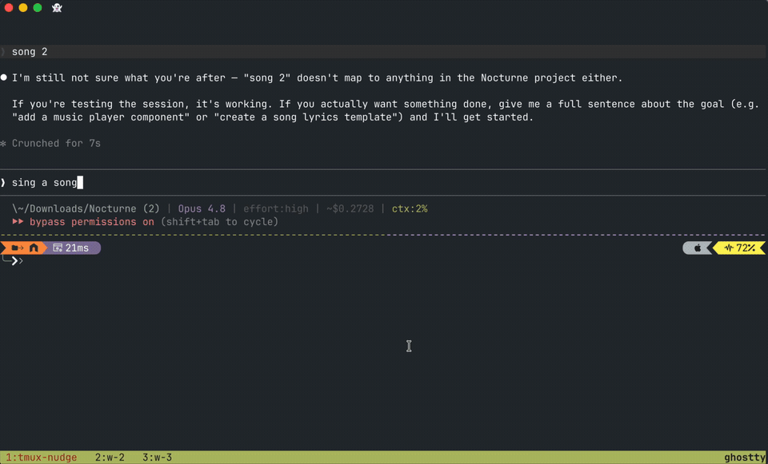

# tmux-nudge

A tmux plugin that **nudges you when a pane needs a human** — by blinking a label
on the pane and its entry in the status bar. Anything can nudge you: a finished
shell script, an idle build, or an AI coding agent waiting for your response.



## Why

Existing tools split the problem in two and solve neither completely:

- **Generic completion notifiers** (`monitor-silence`, `tmux-notify`, `noti`,
  `undistract-me`) only know "the process stopped." They can't tell *done* from
  *waiting for input*, and modern AI-agent TUIs redraw constantly, so silence/
  activity monitoring misfires on them.
- **AI-agent indicators** (e.g. `tmux-agent-indicator`) read agent hooks and get
  precise state, but are AI-only, use **static** border colours, and can't style
  individual (non-active) panes independently.

`tmux-nudge` unifies both behind **one renderer**: pluggable trigger sources feed
a single "make this pane demand attention" engine, so the visual treatment is
identical no matter what triggered it — shell, script, or AI.

## How it works

Pluggable **trigger sources** feed one **renderer**, so the signal is identical
no matter what flagged the pane:

| Trigger          | Source                                   | Covers                                 |
| ---------------- | ---------------------------------------- | -------------------------------------- |
| AI agents        | the shared `agent-hook.sh` (Claude Code, Kiro) → `nudge sync` | AI agents (waiting / done / error) |
| Other harnesses  | `nudge hook` (Codex, aider, …)            | AI agents (needs-input / done / error) |
| Shell completion | `shell/nudge.sh` precmd (zsh/bash)        | any long-running command               |
| Manual / scripts | `nudge on`                                | anything                               |

A flagged pane is marked two ways, both **per-pane** (no shared-border ambiguity):

- a **blinking label** on the pane's own border row (`● tmux-nudge — needs you`)
- the pane's **window entry blinks** in the status bar — but only while that
  window is **not** the one you're currently on

A small daemon animates the blink and **auto-clears** any flagged pane the moment
you view it (mouse, keyboard, or window switch alike). It starts on the first
nudge and exits when none remain.

## Status

Working end to end on tmux 3.6b: engine + renderer, the shared agent hook (Claude
Code, Kiro), Codex via `nudge hook`, the generic shell trigger, and safe
install/uninstall. `tests/contract_test.sh` checks it all end to end on an
isolated tmux server.

### Try it live (isolated — won't touch your real session)

```sh
# from a PLAIN terminal (not inside tmux):
experiments/try-engine.sh
# … watch the flagged pane's label blink and its window entry blink; C-b d, then:
tmux -L nudgedemo kill-server
```

### CLI

```sh
nudge init                      # set up the renderer (done by nudge.tmux); saves your config
nudge install                   # wire shell + Claude + Kiro integrations (idempotent, backups)
nudge uninstall                 # fully reverse init; restores your config
nudge on  [-t pane] [-s state]  # state: needs-input | done | error
nudge off [-t pane]
nudge sync -t pane              # redraw a pane from its shared @agent_state
nudge status
```

`init` is non-destructive: it saves your `pane-border-format` and composes with
it (non-nudging panes keep your look), and installs **no** tmux hooks — auto-clear
is daemon-driven. `uninstall` restores your format exactly (and strips any focus
hooks left by older versions, leaving your own untouched).

## Install

Pick **one** of the two routes below. Either way, on first load tmux-nudge sets
up the renderer **and auto-wires the shell + Claude Code + Kiro CLI
integrations** for whatever you have installed — idempotently, backing up each
file it edits (`*.nudge-bak-*`, `*.agent-hook-bak-*`), appending to your existing
hooks rather than overwriting them. The agent hooks need `jq`.

### Option A — TPM (recommended)

With [TPM](https://github.com/tmux-plugins/tpm), add one line and press `prefix + I`:

```tmux
set -g @plugin 'harnessed-ai/tmux-nudge'
```

TPM clones it to `~/.tmux/plugins/tmux-nudge`. Update later with `prefix + U`.

### Option B — local clone (for hacking on it)

Clone anywhere and load it from your tmux config like any other `run-shell` plugin:

```sh
git clone https://github.com/harnessed-ai/tmux-nudge ~/src/tmux-nudge
```
```tmux
run-shell '~/src/tmux-nudge/nudge.tmux'
```

Your edits are live — no reinstall.

### Auto-wiring controls

```tmux
set -g @nudge-auto-install off   # skip the auto-wiring entirely
```
```sh
nudge install                    # run the wiring manually, any time
```

### Switching between the two (seamless)

All the integration paths (Claude/Kiro hooks, the `~/.zshrc` source line) point
at whichever checkout loaded them. When you switch routes, `nudge install`
**repairs those paths automatically** on the new checkout's first load — no
manual editing of your Claude/Kiro/shell config. You only need to:

1. Remove the **other** load line from your tmux config (delete the `run-shell`
   line if moving to `@plugin`, or vice-versa) so it isn't loaded twice.
2. Reload tmux. The new checkout's auto-install repoints everything to itself.

(Removing the old checkout folder is then safe.)

## Configuration

Everything is customisable via tmux options — set them in your tmux config
**before** tmux-nudge loads. Defaults match the out-of-box look:

```tmux
# colours (the "on" phase of the blink)
set -g @nudge-color-needs-input colour214   # orange
set -g @nudge-color-done        colour46    # green
set -g @nudge-color-error       colour196   # red
set -g @nudge-dim               colour238   # the "off" phase — pick one that
                                            # contrasts with your background,
                                            # or the blink can be invisible

# labels shown on the pane's border row
set -g @nudge-label-needs-input "● tmux-nudge — needs you"
set -g @nudge-label-done        "✓ tmux-nudge — done"
set -g @nudge-label-error       "✗ tmux-nudge — error"

set -g @nudge-interval     0.5   # blink speed, seconds per phase
set -g @nudge-window-blink on    # also blink the window's status-bar entry (off to disable)
set -g @nudge-min-seconds  15    # shell trigger: only nudge for commands longer than this

# when a nudge clears (a shared setting, so every plugin using the agent hook agrees):
#   focus  — as soon as you look at (focus) the pane   [default]
#   prompt — only when you engage the pane (your next prompt / shell command),
#            so switching to a window with several nudges shows them all
#            until you handle each
set -g @agent-seen-on focus
# (the older `@nudge-clear-mode focus|interaction` still works when this isn't set)
```

Any option can also be overridden per-invocation with the matching `NUDGE_*`
env var. Changing `@nudge-dim` takes effect after a reload (`nudge init` or a
tmux config reload), since it's baked into the border format at init.

## AI harness integration

**Claude Code and Kiro CLI** report through the shared harnessed-ai hook,
`scripts/agent-hook.sh`, which writes the pane's `@agent_state`. nudge doesn't
install hooks of its own: it registers as a listener (`@agent-on-change-nudge`)
and redraws the pane whenever that state changes.

| Agent state | When | Nudge |
| --- | --- | --- |
| waiting (`blocked`) | a permission prompt or question | `needs-input` (orange) |
| `done` | the agent finished a turn | `done` (green) |
| `error` | the turn failed | `error` (red) |
| busy / idle | working, or you replied | cleared |

Other tmux plugins can use the same hook (each ships an identical copy) and read
the same state. nudge works the same alone or alongside them. With several
installed, each agent event still runs **one** hook: it's registered once per
event, a copy is never replaced by an older one, and uninstalling one plugin hands
the hook to another that's still loaded instead of removing it. When you look at
a finished agent, it's marked seen in the shared state (`agent-hook.sh --seen`),
so every plugin clears it together. A waiting agent's
label is dismissed when you look at it, but the agent stays *waiting* until you
answer.

Upgrading from an older tmux-nudge: the first load after the update re-runs the
installer once, which removes the old `nudge hook …` entries from Claude Code and
Kiro and registers the shared hook. `nudge claude-config` / `nudge kiro-config`
print the equivalent config for manual setup.

**Codex and other harnesses** (aider, gemini-cli, opencode, …) can still drive
nudge directly with the harness-neutral command:

```sh
nudge hook <needs-input|done|error|clear>
```

It finds the agent's pane from `$TMUX_PANE`, ignores any payload the harness
appends (JSON on stdin or argv), and **never exits non-zero**. For Codex,
`nudge codex-config` prints the `notify` line for `~/.codex/config.toml`
(`agent-turn-complete` → `needs-input`; clears on focus). This applies to CLI
harnesses running **inside tmux**; a GUI IDE not in a tmux pane is out of scope.

## Any long-running command (generic)

Not just AI — get nudged when *any* foreground command finishes (builds, tests,
`ssh`, scripts). Enable the shell integration in `~/.zshrc` or `~/.bashrc`:

```sh
eval "$(/path/to/tmux-nudge/bin/nudge shell-init)"
# or: source /path/to/tmux-nudge/shell/nudge.sh
```

When a command runs longer than `$NUDGE_MIN_SECONDS` (default 15) it nudges its
pane on completion — **success → done (green), failure → error (red)** — but
only if you've **switched away** from that pane, so it never nags a pane you're
watching. Focus the pane to clear it.

It also publishes the finished command in the shared state (`@agent_tool shell`,
named after the command), so plugins that list agents can show it too. It's
cleared once you've looked at it or start the next command.

### Feasibility spikes

Throwaway demos from early feasibility work:
[`experiments/blink-spike.sh`](experiments/blink-spike.sh) (per-pane border
colour — since dropped, as it colours the shared divider) and
[`experiments/label-spike.sh`](experiments/label-spike.sh) (single-pane label —
the approach that shipped).

## License

MIT
